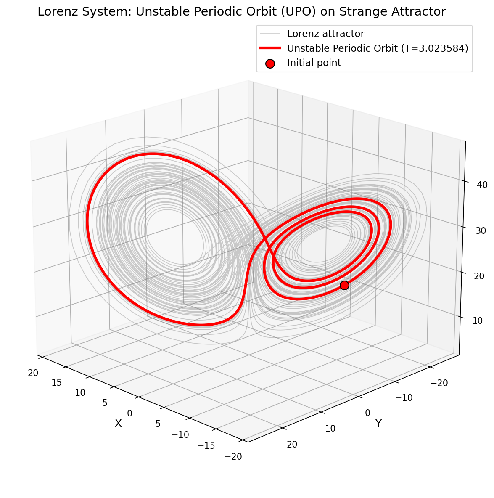

<!-- Author: Dr. Denys Dutykh (Mathematics Department, Khalifa University of Science and Technology, Abu Dhabi, UAE) -->

# LorenzUPOs: unstable periodic orbits of the Lorenz system by automatic differentiation



An unstable periodic orbit found by the script (in red), of period T = 3.084277, drawn on the Lorenz attractor (in
grey) for σ = 10, ρ = 28 and β = 8/3; the red dot is its initial point. The orbit winds twice around each wing of the
attractor. Its optimisation took 16 iterations of L-BFGS and ended with a periodicity residual below 10⁻⁶
(`images/lorenz_periodic_orbit_history.png`).

LorenzUPOs is a Python script that finds unstable periodic orbits of the Lorenz system, the periodic solutions that
form the skeleton of its chaotic attractor. It takes the closest return of a long chaotic trajectory as a first
guess, then minimises a differentiable measure of non-periodicity over the initial point and the period with the
L-BFGS method, the gradients being computed exactly by the automatic differentiation of PyTorch through the DOPRI5
integrator of torchdiffeq, and finally checks the orbit over three periods and plots it.

## The problem

The Lorenz system, with the classical parameters of its chaotic regime,

```text
dx/dt = σ (y − x),     dy/dt = x (ρ − z) − y,     dz/dt = x y − β z,     σ = 10,  ρ = 28,  β = 8/3,
```

is written `dX/dt = f(X)` with `X = (x, y, z)`, and `φ(T, X₀)` denotes the state reached from `X₀` after a time
`T`. A periodic orbit of period `T` is a zero of `φ(T, X₀) − X₀` at a point where `f(X₀) ≠ 0`. The script minimises

```text
J(X₀, s) = |φ(T, X₀) − X₀|² + λ / (|f(X₀)|² + ε),     T = t_min + exp(s),
```

over the initial point `X₀` and the unconstrained variable `s = log(T − t_min)`, with `λ = 10⁻³`, `ε = 10⁻¹²` and
`t_min = 1`. The first term measures how far the trajectory is from closing up after one period; the second grows
near the three equilibria, where `f(X₀) = 0`, and keeps the minimiser away from them.

## Method

The first guess comes from a trajectory integrated over a time of 2000, sampled at 400 000 points, from a random
initial condition in the box `[−20, 20] × [−30, 30] × [0, 50]`. A k-d tree (`scipy.spatial.cKDTree`) finds, among
the pairs of points of this trajectory separated in time by 4 to 8, the pair closest in phase space, which gives a
first period `T₀` and a first initial point: a chaotic trajectory keeps returning near its earlier states, and a close
return suggests a periodic orbit nearby.

The cost `J` is then minimised by `torch.optim.LBFGS`, a limited-memory quasi-Newton method, with a history of 25
updates and a strong Wolfe line search. Its gradient with respect to `(X₀, s)` is computed by the automatic
differentiation of PyTorch through the integrator, so that no derivative is approximated by finite differences. The
minimisation stops when the cost changes by less than the tolerance `tol` relative to `1 + |J|`, or after `max_iter`
iterations. Every integration uses the adaptive DOPRI5 scheme of Dormand and Prince, of order five, in double
precision with the tolerances `rtol = atol = 10⁻⁹`, since a chaotic flow amplifies every error.

The optimised orbit is finally integrated over three periods, and the distance to its initial point is printed at
`T`, `2T` and `3T`. Two figures show the orbit on the attractor and the history of the cost, the periodicity
residual, the period and the norm of the gradient. The initial condition of the first trajectory is random, so the
orbit found changes from one run to the next; setting `REPRODUCIBLE = True` at the top of the script fixes the seed
(`SEED = 1`).

## Quick start

```bash
# Default run
python lorenz_periodic_orbit.py

# Custom parameters
python lorenz_periodic_orbit.py --lambda 0.001 --max-iter 1000 --tol 1e-7

# High-precision integration
python lorenz_periodic_orbit.py --rtol 1e-10 --atol 1e-10
```

| Option | Meaning | Default |
|---|---|---|
| `--rtol FLOAT` | relative tolerance of the ODE solver | 1e-9 |
| `--atol FLOAT` | absolute tolerance of the ODE solver | 1e-9 |
| `--lambda FLOAT` | weight λ of the penalty | 1e-3 |
| `--max-iter INT` | maximum number of L-BFGS iterations | 500 |
| `--tol FLOAT` | relative change of the cost that stops the optimisation | 1e-6 |

The script prints the progress of the integration and of the optimisation, the errors at `T`, `2T` and `3T`, and
the final orbit. It saves the orbit as `images/lorenz_periodic_orbit.png` and the history as
`images/lorenz_periodic_orbit_history.png`; when these names are already taken, it appends the first free number
(`_1`, `_2`, ...), so that earlier results are never overwritten.

## Contents

| File | What it holds |
|---|---|
| `lorenz_periodic_orbit.py` | the script |
| `images/lorenz_periodic_orbit.png`, `images/lorenz_periodic_orbit_history.png` | a first run: the orbit of period 3.084277 shown at the top of this page, and the history of its optimisation |
| `images/lorenz_periodic_orbit_1.png`, `images/lorenz_periodic_orbit_history_1.png` | a second run, from another random first guess: an orbit of period 4.417766, which winds four times around one wing and once around the other |
| `LICENSE`, `LGPL-3.0.txt` | the GNU Lesser General Public License, version 3 (the same text in both files) |
| `CITATION.cff` | the citation of the software |

## Requirements

Python 3.8 or later, with PyTorch, torchdiffeq, NumPy, SciPy, Matplotlib and tqdm (the progress bar of the long
integration). From PyTorch 2.0 on, the right-hand side of the Lorenz system is compiled with `torch.compile`;
earlier versions run it uncompiled.

## References

E. N. Lorenz, Deterministic nonperiodic flow, Journal of the Atmospheric Sciences 20, 130–141 (1963).

https://doi.org/10.1175/1520-0469(1963)020%3C0130:DNF%3E2.0.CO;2

J. R. Dormand and P. J. Prince, A family of embedded Runge–Kutta formulae, Journal of Computational and Applied
Mathematics 6, 19–26 (1980).

https://doi.org/10.1016/0771-050x(80)90013-3

## How to cite

No article accompanies this script. If you use it, please cite the software:

D. Dutykh, LorenzUPOs: unstable periodic orbits of the Lorenz system by automatic differentiation, software,
version 1.0.0 (2026).

https://github.com/dutykh/LorenzUPOs

The button "Cite this repository" in the right-hand column of this page gives the same reference, read from
`CITATION.cff`.

## Licence

GNU Lesser General Public License, version 3 (see `LICENSE`; the same text is kept in `LGPL-3.0.txt`).

## Author

Denys Dutykh (Mathematics Department, Khalifa University of Science and Technology, Abu Dhabi, UAE), who wrote the
script in May 2025.

https://www.denys-dutykh.com/
